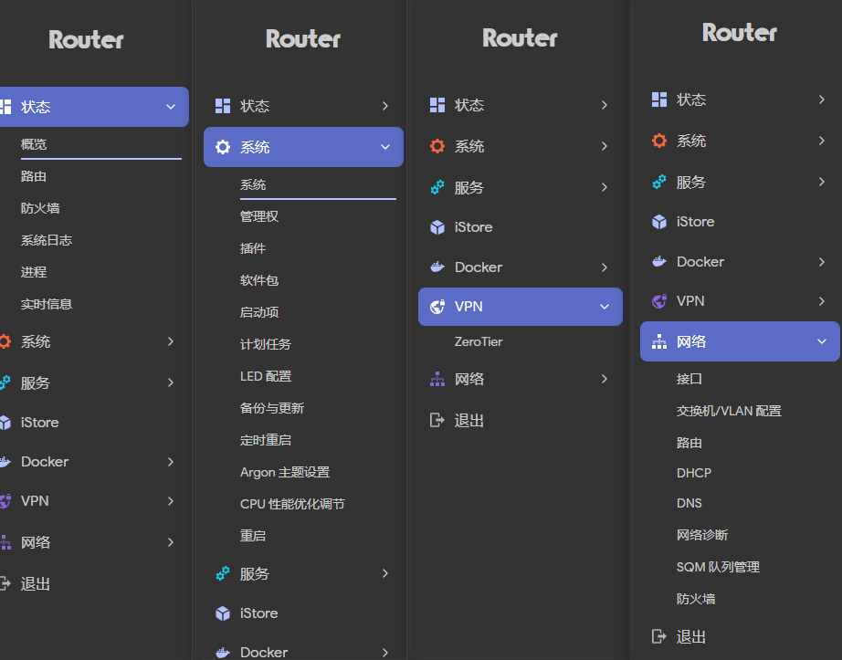

***

## 1. 项目信息

- **参考脚本**：<https://github.com/ZqinKing/wrt_release.git>
- **源码来源**：<https://github.com/VIKINGYFY/immortalwrt.git> - main
- **代码fork**： <https://github.com/wzdddyy/Link_NN6000V2/>
- **设备支持**：Link_NN6000V2，内核分区 12m（固件包含带 WiFi 和不带 WiFi 版本）
- **固件发布**：[点击下载](https://github.com/meverify-hyh/Link_NN6000V2/releases)
- **默认 LAN IP**：`192.168.2.254`
- **WiFi**：名称 `500/5`，密码 `147258369`，首次启动默认禁用

***

## 2. 预装插件

| 插件 | 说明 |
|---|---|
| **luci-app-store** | iStore 应用商店 |
| **luci-app-dockerman** | Docker 容器管理 |
| **luci-app-passwall** | 代理插件（sing-box 内核） |
| **luci-app-adguardhome** | 广告过滤 DNS |
| **luci-app-lucky** | 端口转发 / 内网穿透 |
| **luci-app-oaf** | 应用过滤 |
| **luci-app-zerotier** | ZeroTier 虚拟组网 |
| **luci-app-easytier** | EasyTier 虚拟组网 |
| **luci-app-upnp** | UPnP 自动端口映射 |
| **luci-app-autoreboot** | 定时重启 |
| **luci-app-bandix-plus** | 流量监控 |
| **luci-app-cpufreq** | CPU 频率调节 |
| **luci-app-lldpd** | LLDP 链路发现 |
| **luci-theme-argon** | Argon 主题 |

**命令行工具**：sing-box、curl、wget、htop、tcpdump、mtr、socat、iperf3、ethtool、bash、qrencode、smartmontools、usbutils、xz-utils、openssh-sftp-server

**已禁用**：homeproxy、openclash、v2raya、wireguard、istorex、quickfile、ttyd、diskman、smartdns、sqm、samba4、hd-idle、p910nd、pbr

***

## 3. 关键配置

- **NSS VLAN 修复**：禁用了 `kmod-qca-nss-drv-vlan-mgr` / `bridge-mgr` / `lag-mgr` / `netlink` / `qdisc` / `igs`，解决 LAN 口间转发失败
- **ath11k NSS**：禁用 `ATH11K_NSS_SUPPORT`，保留 WiFi + VLAN client 修复
- **防火墙**：nftables + `kmod-nft-fullcone`，iptables 兼容层已禁用
- **DNS**：dnsmasq-full + conntrack
- **内核**：BBR 拥塞控制、USB 存储 / 网卡 / 串口驱动全选

***

## 4. 项目结构

```
Link_NN6000V2/
└── nn6000v2/
    ├── configs/
    │   └── link_nn6000v2_immwrt.config   # 固件配置
    ├── patches/
    │   ├── 992_network_config.sh          # 网络初始化（PPPoE/VLAN）
    │   ├── xray-core/                     # 项目内 xray-core 包（覆盖 feeds）
    │   │   ├── Makefile
    │   │   └── files/
    │   ├── cpuusage/
    │   ├── hnatusage/
    │   ├── smp_affinity/
    │   └── tempinfo/
    └── scripts/
        ├── build.sh                       # 编译主脚本
        └── update.sh                      # 源码更新脚本
```

***

## ImmortalWrt

<div align="center">



</div>
***
